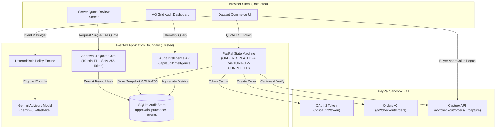

# LicenseFlow Guard v1.0

**Rights-aware AI dataset discovery, deterministic policy enforcement, PayPal Sandbox checkout, provenance receipts, and AG Grid procurement intelligence.**

> **Hackathon Prototype**: Built for the **PayPal AI Hackathon 2026**. Demonstrates evidence-backed AI recommendations, deterministic licensing refusals, server-persisted approval quotes, verified PayPal Sandbox captures, and enterprise audit telemetry. Catalog metadata, dataset samples, and licensing tags (`LF-DEMO-*`) are **synthetic**. Payments run strictly on the **PayPal Sandbox API** (`https://api-m.sandbox.paypal.com`) and do not process real funds.

---

## Key Capabilities

1. **Deterministic Rights & Budget Gate**: Evaluates commercial use, model training, and redistribution constraints against declared license manifests before any purchase or AI matching.
2. **Resilient Gemini AI Advisory**: Uses Google Gemini (`gemini-3.5-flash-lite`, 500 RPD free quota) with an automated fallback chain (`gemini-3.7-flash` → `gemini-3.5-flash`), in-memory recommendation caching, fail-fast quota protection (429/404), and transient overload retries (503). Model output is strictly advisory and cannot override policy.
3. **Server-Bound Approval Quotes**: Implements single-use, 10-minute server-persisted quotes (`/api/quotes`) cryptographically bound to dataset ID, snapshot price, currency `USD`, and declared buyer intent to prevent client-side price tampering.
4. **Hardened PayPal Sandbox Orders v2 (APIMatic Context Integration)**:
   - Built following the official **APIMatic PayPal Context Plugin** specifications.
   - In-memory OAuth2 token caching with proactive refresh and `asyncio.Lock()` double-checked locking.
   - Standard `Prefer: return=representation` and deterministic `PayPal-Request-Id` headers.
   - Automated timeout reconciliation: network drops during capture query read-only order details before failing closed.
   - Structured error extraction reporting PayPal `debug_id` without exposing credentials.
5. **Procurement Security Intelligence Dashboard (AG Grid & AG Charts)**:
   - Interactive audit dashboard powered by **AG Grid Community v32** and **AG Charts Community v10** in LicenseFlow's dark & lime palette.
   - Live metrics separating persisted SQLite records from synthetic test invariants.
   - Multi-column filtering, quick search, keyboard accessibility, and CSV audit export.
   - Read-only Decision Inspector displaying bound constraints, licensing manifests, and SHA-256 integrity digests.
   - Air-gapped Security Telemetry Advisor answering natural language audit queries with strict financial execution prohibitions.
   - Documented feasibility evaluation of **AG Studio 3.1** embedded analytics at `/ag_studio_feasibility.html`.

---

## Sponsor Track Integration Evidence

### 1. APIMatic PayPal Integration
- **Plugin Registered**: The official APIMatic PayPal Context Plugin (`context-plugins/paypal`) was validated and natively installed into the Antigravity CLI environment (`agy plugin install`).
- **Architectural Contribution**: Applied APIMatic's `python-integrate-paypal`, `python-authentication`, `python-configuration-resilience`, and `python-error-handling` guidance:
  - Token caching and eviction on 401 in [`app/paypal.py`](app/paypal.py).
  - Ambiguous capture timeout reconciliation via read-only `get_order_details`.
  - Atomic compare-and-swap state machine (`ORDER_CREATED -> CAPTURING -> COMPLETED`).
  - Unit and resilience tests in [`tests/test_paypal_resilience.py`](tests/test_paypal_resilience.py).

### 2. AG Grid & AG Studio Analytics
- **Primary Dashboard**: Built with **AG Grid Community v32.2.0** and **AG Charts Community v10.2.0** (MIT licensed, zero cost/keys, 100% reproducible offline with bundled vendor assets in `static/vendor/`).
- **Feasibility Evaluation**: Documented trial evaluation of the enterprise **AG Studio 3.1** library (`ag-studio` on npm) at [`static/ag_studio_feasibility.html`](static/ag_studio_feasibility.html), assessing `agStudio.createStudio(...)` against trial licensing terms.
- **Auditing & Governance**: Full unit and integration coverage in [`tests/test_audit_dashboard.py`](tests/test_audit_dashboard.py).

---

## System Requirements

- Python 3.10 or newer (tested on Python 3.11, 3.12, 3.15)
- PayPal Developer Sandbox account (Business REST credentials + Personal buyer account)
- Google Gemini API key (optional; deterministic policy filtering operates offline without AI)
- Modern web browser (Chrome, Edge, Firefox, Safari)

---

## Clean Installation & Quickstart

```bash
# 1. Clone the repository
git clone https://github.com/Aryan-Shastri/licenseflow-guard.git
cd licenseflow-guard

# 2. Create and activate a virtual environment
python -m venv .venv

# On Windows PowerShell:
.\.venv\Scripts\Activate.ps1
# On Linux / macOS:
source .venv/bin/activate

# 3. Install dependencies
pip install -r requirements.txt

# 4. Configure local environment variables
cp .env.example .env
# Edit .env and supply your credentials:
# PAYPAL_CLIENT_ID=your_sandbox_client_id
# PAYPAL_CLIENT_SECRET=your_sandbox_secret
# GEMINI_API_KEY=your_gemini_api_key (optional)
# APP_SIGNING_KEY=generate_with_python_secrets

### Obtaining Judge / Evaluator Credentials

1. **PayPal Developer Sandbox Credentials**:
   - Log in to the [PayPal Developer Dashboard](https://developer.paypal.com/).
   - Navigate to **Apps & Credentials** and select the **Sandbox** tab.
   - Click **Create App** (or select the **Default Application**).
   - Copy the generated **Client ID** and **Secret** into your `.env` file as `PAYPAL_CLIENT_ID` and `PAYPAL_CLIENT_SECRET`.
   - Under **Sandbox Accounts** in the dashboard, locate or create a personal test buyer account. You will use this sandbox buyer account's login credentials in the PayPal popup during checkout. (No actual bank account or real money is ever charged).
2. **Google Gemini API Key (Optional)**:
   - Visit [Google AI Studio](https://aistudio.google.com/apikey).
   - Click **Create API Key** and paste it into `.env` as `GEMINI_API_KEY`.
   - Model defaults to `gemini-3.5-flash-lite` (500 RPD free tier).
   - If omitted, LicenseFlow Guard automatically operates in offline deterministic mode: catalog rights filtering and budget checks remain 100% active.
3. **App Signing Key**:
   - Generate a cryptographically secure 32-byte secret in your terminal:
     ```bash
     python -c "import secrets; print(secrets.token_hex(32))"
     ```
   - Paste the resulting string into `.env` as `APP_SIGNING_KEY`.

# 5. Run automated test suite
pytest tests/ -v

# 6. Launch the server
uvicorn app.main:app --host 127.0.0.1 --port 8000
```

Open your browser at **http://127.0.0.1:8000**.

---

## Verification Test Suite (50 Automated Tests)

Run the full automated test suite locally:

```bash
python -m pytest tests/ -v
```

The 50 tests cover:
- **`tests/test_policy.py` (6 tests)**: Deterministic rights filtering, budget enforcement, and SHA-256 formatting.
- **`tests/test_ai_resilience.py` (10 tests)**: Gemini 3.5 fallback, error classification (404, 429 daily quota, 429 rate limit, 503 overload), recommendation caching, and untrusted output sanitization.
- **`tests/test_api.py` (9 tests)**: Health checks, quote minting, server-side approval verification, replay defense, and token-gated dataset downloads.
- **`tests/test_paypal_resilience.py` (7 tests)**: OAuth2 token caching, 401 invalidation, `Prefer: return=representation` headers, network timeout capture reconciliation, fail-closed validation, and structured error reporting.
- **`tests/test_audit_dashboard.py` (8 tests)**: AG Grid audit intelligence endpoint, sensitive secret stripping, status filtering, strict access tokens, AG Studio feasibility page loading, query length validation, and read-only AI agent guardrails.
- **`tests/test_security_adversarial.py` (10 tests)**: Scoped adversarial test fixtures (prompt injection, quote tampering, replay attacks, concurrent capture races, premature downloads).

---

## Architecture



---

## API Summary

- `GET /api/health` — service health and sandbox status.
- `GET /api/config` — sandbox and AI capability flags.
- `GET /api/catalog` — synthetic dataset collection and metadata.
- `POST /api/eligibility` — deterministic buyer rights and budget verification.
- `POST /api/match` — resilient Gemini structured recommendations (filtered by server).
- `POST /api/quotes` — generates server-persisted single-use approval quote (10-minute TTL).
- `POST /api/purchases` — validates quote binding, consumes approval, and creates PayPal sandbox order.
- `POST /api/purchases/{id}/capture` — captures PayPal order with atomic state compare-and-swap.
- `GET /api/purchases/{id}/receipt` — token-gated provenance receipt with immutable snapshot.
- `GET /api/purchases/{id}/download` — token-gated CSV dataset download.
- `GET /api/audit/intelligence` — sanitized procurement telemetry for AG Grid dashboard.
- `POST /api/audit/agent/query` — air-gapped read-only telemetry intelligence advisor.
- `GET /ag_studio_feasibility.html` — AG Studio 3.1 embedded analytics evaluation test harness.

---

## Security Boundaries & Responsible Disclosures

1. **Hackathon Sandbox Only**: Operates strictly within PayPal Sandbox (`api-m.sandbox.paypal.com`). No production credentials or live banking rails are configured.
2. **Untrusted Model Outputs**: Gemini outputs are treated as advisory recommendations. Catalog IDs and rights permissions are strictly validated by the server before any quote generation.
3. **Single-Use Replay Protection**: Approval tokens are hashed (`SHA-256`), verified with constant-time comparison (`hmac.compare_digest`), and atomically transitioned to `CONSUMED` on purchase creation.
4. **No Financial AI Agents**: The telemetry advisor is air-gapped and prohibited from authorizing purchases or creating PayPal orders.
5. **No Production Claims**: This demo does not constitute certified legal rights licensing or enterprise compliance certification.

---

## License

Code is licensed under the [MIT License](LICENSE).
Synthetic sample datasets and demo manifests are provided for hackathon demonstration purposes only.
