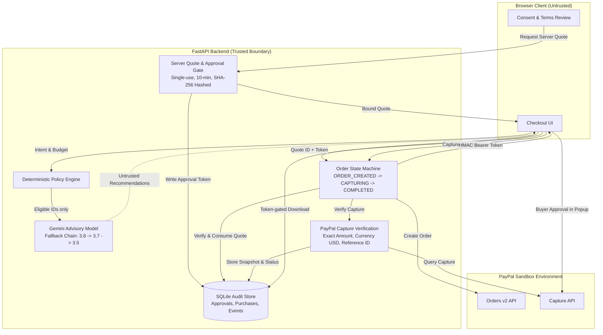

# LicenseFlow AI

**Rights-aware dataset discovery + AI ranking + PayPal sandbox checkout + provenance receipts.**

> Hackathon **prototype**, not a production marketplace or legal certification system. The entire catalog, license flags and datasets are **synthetic**. The payment path uses **PayPal Sandbox only**; it does not move real funds.

## What works

1. Select explicit rights and budget constraints. A deterministic policy engine blocks incompatible products.
2. Optionally ask Gemini to rank only policy-eligible datasets and explain limitations.
3. Use PayPal JavaScript SDK v5 and the server-side **Orders v2** API to create a real sandbox order.
4. The buyer approves payment in PayPal Sandbox. The server requires the unguessable checkout-session token, captures the approved PayPal order, then checks **order reference, currency, exact amount and completed capture status**.
5. A token-gated receipt records the PayPal capture ID, illustrative license metadata and the dataset's SHA-256 digest. A verified purchase unlocks the synthetic CSV.

**AI cannot approve payments, override licensing policy, or access PayPal credentials.**

## Requirements

- Python 3.11 or newer (Python 3.11/3.12 recommended)
- PayPal Developer account with sandbox **business** app and sandbox **personal** buyer account
- Google Gemini API key for real AI matching
- An internet connection for both services

## Quickstart (Windows PowerShell)

```powershell
cd licenseflow-ai
py -3 -m venv .venv
.\.venv\Scripts\Activate.ps1
python -m pip install -r requirements.txt
Copy-Item .env.example .env
python -c "import secrets; print(secrets.token_hex(32))"
# Paste a random APP_SIGNING_KEY plus your keys into .env (never commit it)
python -m uvicorn app.main:app --host 127.0.0.1 --port 8000 --reload
```

Open **http://127.0.0.1:8000**.

On macOS/Linux, use `python3 -m venv .venv`, `source .venv/bin/activate` and `cp .env.example .env`.

### Obtain credentials

1. Go to [PayPal Developer Dashboard](https://developer.paypal.com/dashboard/). Create/select a sandbox **business** REST app; copy its **Client ID** and **Secret** to `.env` as `PAYPAL_CLIENT_ID` and `PAYPAL_CLIENT_SECRET`.
2. In **Testing Tools → Sandbox Accounts**, locate or create a **personal** buyer account; use its credentials **only inside the PayPal Sandbox login popup**. Never place buyer passwords in `.env`, code, or README.
3. Create an API key at [Google AI Studio](https://aistudio.google.com/apikey). Set `GEMINI_API_KEY` in `.env`. `GEMINI_MODEL` defaults to `gemini-3.8-flash`; choose a model actually available to your account if needed.
4. Generate a random signing key and set `APP_SIGNING_KEY`; a missing key creates an **ephemeral** key, making previously issued tokens invalid after restart.

The PayPal JavaScript SDK displays the sandbox checkout UI based on the app's sandbox client ID. The backend never uses `api-m.paypal.com`: all requests go to `api-m.sandbox.paypal.com`.

**Note for India-based developers:** Eligibility for this hackathon and availability of PayPal developer accounts are separate. For sandbox buyer tests with USD, a US-region personal sandbox payer may work when an India-region payer does not; verify against current PayPal account availability and rules. Never use live financial credentials to bypass country limitations.

## Architecture



## Verification tests

```bash
# Run complete test suite (unit, policy, integration, adversarial)
../.venv/Scripts/python.exe -m pytest tests/ -v
```

These automated tests include mocked PayPal and Gemini fixtures, along with 10 parameterized adversarial security regressions in `tests/test_security_adversarial.py`. They **do not** claim that live network integrations succeed without credentials. Live PayPal Sandbox checkout and live Gemini inference should be verified independently with active credentials.

## Demo flow

1. Set budget to **$35**, commercial use = yes, model training = yes, redistribution = no.
2. Click **Apply rights filter only**: `support-intent` and `safe-security` are eligible; `civic-dialogue` (non-commercial) and `retail-demand` (over-budget $44) are blocked with explicit rationales.
3. Click **Match with AI**: Gemini provides advisory ranking for eligible datasets without modifying policy.
4. Select `support-intent`; review the illustrative license manifest, then check the approval box to mint a server-persisted single-use quote.
5. Complete PayPal sandbox checkout with the personal **sandbox** buyer account.
6. Observe **PayPal capture verified**. Download the CSV dataset and JSON provenance receipt, and verify its SHA-256 hash.

### Acceptance test

A reviewer can run the commands, see a model-generated recommendation when the key is configured, complete a genuine sandbox checkout with their own sandbox accounts, and receive the dataset **only after** PayPal returns a confirmed matching capture. A nonmatching/declined/aborted capture must not unlock access.

## API summary

- `GET /api/health` — service health and sandbox status
- `GET /api/config` — client configuration flags (sandbox mode, feature flags)
- `GET /api/catalog` — synthetic product registry and digest
- `POST /api/eligibility` — deterministic buyer-intent filter
- `POST /api/match` — Gemini advisory ranking with fallback resilience, results filtered by server
- `POST /api/quotes` — generates server-persisted single-use approval quote (10 min TTL)
- `POST /api/purchases` — validates quote binding, consumes token, and creates PayPal sandbox order
- `POST /api/purchases/{id}/capture` — atomic capture verification against snapshot price and reference
- `GET /api/purchases/{id}/receipt` — requires receipt bearer token; returns immutable snapshot
- `GET /api/purchases/{id}/download` — token-gated CSV data download for completed purchases
- `GET /api/docs` — automatically generated API documentation

## Security boundaries and open work

- **Current scope:** single PayPal sandbox merchant; synthetic catalogs; one-user locally hosted demo; no login, tenant isolation, automated catalog ingestion, revocation, refunds, or recurring billing.
- **Never deploy publicly as-is:** add proper login/session management, per-user ownership, rate limits, CSRF protections where applicable, webhooks with signature verification, robust idempotency/reconciliation, observability, secure secret storage and abuse prevention. Prevent unrestricted access to AI endpoints with an actual authorization layer before hosting.
- The buyer's stated intent is not an enforceable legal license. An arbitrary third-party rights claim must be validated by its legal owner. The SHA-256 proves file-byte identity to this sample distribution, **not** lawful ownership of content.
- Model-output text is untrusted and is only rendered as plain text (`textContent`) to avoid HTML injection.
- An OpenAPI path is available for local testing, but do not expose it or the sandbox endpoints in a real public deployment without access control.

## Hackathon submission

The official challenge requires a public open-source repository, a functioning accessible demo or reproducible setup, an explanatory write-up, and an unlisted/private video **does not qualify**: YouTube video must be **public**, under 3 minutes. See [`docs/PROJECT_BRIEF.md`](docs/PROJECT_BRIEF.md), [`docs/THREAT_MODEL.md`](docs/THREAT_MODEL.md), and [`docs/DEMO_SCRIPT.md`](docs/DEMO_SCRIPT.md).

## Sources

- [PayPal AI Hackathon rules](https://paypalaihackathon.devpost.com/rules)
- [PayPal Orders API](https://developer.paypal.com/whats-an-order/)
- [PayPal Sandbox accounts](https://developer.paypal.com/sandbox-testing/accounts)
- [PayPal JavaScript SDK v5 configuration](https://developer.paypal.com/sdk/js/v5/configuration)
- [Gemini structured outputs](https://ai.google.dev/gemini-api/docs/structured-output)

Code MIT licensed. Data is synthetic sample content generated for this demo. License tags `LF-DEMO-*` are **not** conventional open-data licenses.
