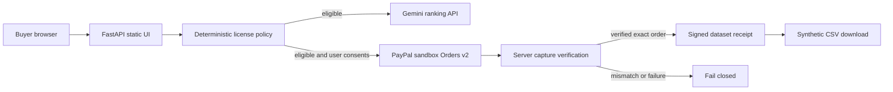

# LicenseFlow AI — Product Brief (hackathon v0.1)

## Buyer and problem

- **User:** AI engineer / ML researcher who needs a dataset and must document permitted uses.
- **Buyer/approver:** Engineering lead, procurement owner, or independent AI developer.
- **Trigger:** New model experiment for a commercial application with a budget and training/redistribution constraints.
- **Workaround:** Read dataset listings and license pages manually, ask sellers questions, buy in a separate workflow and maintain a spreadsheet of receipts.
- **MVP claim:** Make explicit rights easier to compare and tie a PayPal purchase to a reproducible file receipt.
- **Not claimed:** Legal license interpretation, certification of third-party ownership, independent data-quality verification, seller onboarding, or production-marketplace operation.

## User journey

Define goal and spend cap -> deterministic rights filter -> AI ranking of eligible products -> explicit user confirmation -> server-generated PayPal order -> PayPal Sandbox buyer approval -> server capture verification -> token-gated data + hash/receipt.

## Features

- 4 sample products with author-declared, synthetic rights flags.
- Deterministic maximum budget and use-rights checks.
- Gemini explanations constrained to eligible sample products.
- PayPal Orders v2 sandbox checkout and exact capture verification.
- Signed access token + data-download gate and provenance receipt.
- Responsive, keyboard-operable front-end and no private file dependencies.

## Architecture

## Scope constraints

- One demo merchant, USD prices, synthetic files, no real money.
- Structured license flags are authoritative **only within the demonstration**.
- All payments require human initiation and PayPal buyer approval.
- No arbitrary external URLs are fetched and no third-party code is executed.

## Differentiation hypothesis

Generic AI payment bots automate payment. LicenseFlow introduces a testable, narrower buyer problem: machine-readable data-use constraints as a **hard gate** before payment, and a purchased artifact with a recorded byte-level hash. Competitor search is preliminary, not proof of uniqueness or willingness to pay.

## Business validation after hackathon

Interview 5 reachable AI team leads and 2 dataset vendors. Evidence needed: frequency of rights conflicts, current procurement process, buyer-owned budget, vendor's willingness to expose rights metadata and payment route, and vendor onboarding compliance.

**Smallest paid pilot hypothesis:** 1 seller's catalog of approved datasets + 1 internal AI team; charge a fixed integration/setup fee *only if customer discovery supports paid intent*. Pricing and margins remain unknown. Stop after 5 interviews if no buyer describes a recent real rights-related purchase delay or workaround worth fixing.

## Engineering acceptance gates

- Unit tests cover policy and capture mismatch.
- With sandbox credentials, exact PayPal purchase settles and unlocks download.
- Denied, pending, wrong-amount, cancelled or missing payment never unlocks download.
- With Gemini credentials, ranked recommendations contain only rights-eligible IDs.
- README reproduces the build; no secrets in repository.
- Demo video demonstrates payment capture and hash cross-check within 3 minutes.
